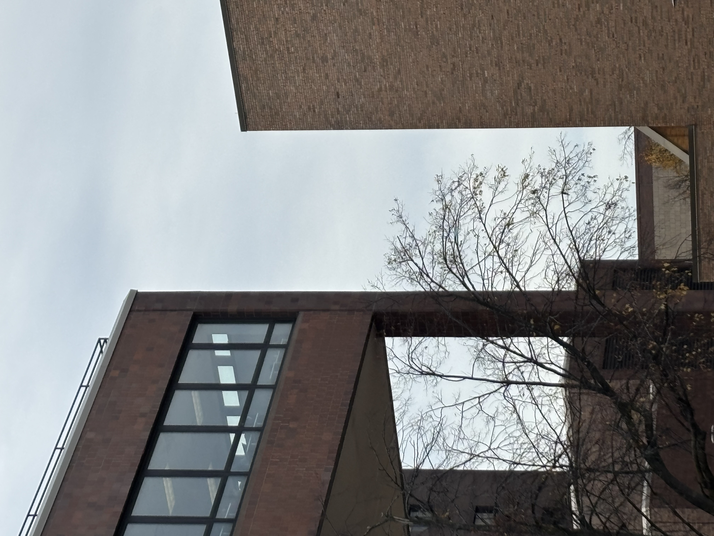

# I spy with my little eye...

## OVERVIEW

Snapped a picture for my instagram. People are asking me where I took this image but I don't remember because it was so long ago.

Flag is in the format CTS{hallName}. You do not need to type the word "hall".

> Points awarded: 15

## THE FLAG

Spoilers below!

The flag is:

<code>CTS{capen}</code> or <code>CTS{fronczak}</code>

## INTENDED SOLUTION

The solution is:

This is a challenge made for UB Students. Capen is one of the most popular halls due to there being Silverman Library (featured in the picture) and also One World Cafe. The hall featured on the right side is Fronczak Hall, which is why that was also accepted.  
   
I'll be honest, I'm not sure how to solve it for a non-UB student.

## PERSONAL THOUGHTS

My personal thoughts on this flag:

 
I took this image on the way to the location of "Hidden Away". It was 11:26AM (and the day of the event) when I took this image. I thought this would be obscure enough but it was not. A very nice introduction to OSINT for those who don't know about it  
 
Difficulty (out of 100): 2 (for UB Students), Gingerbread (for non-UB students) 
Reason: Way easier than intended, almost every group that opened the image got the location.

