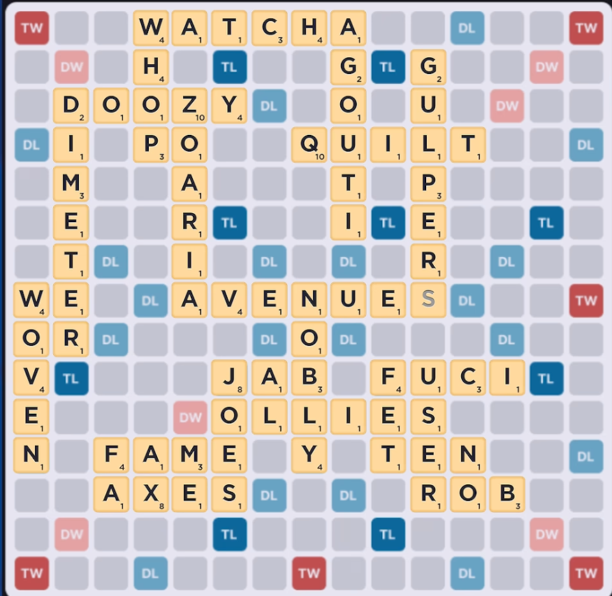
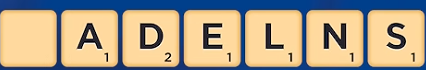
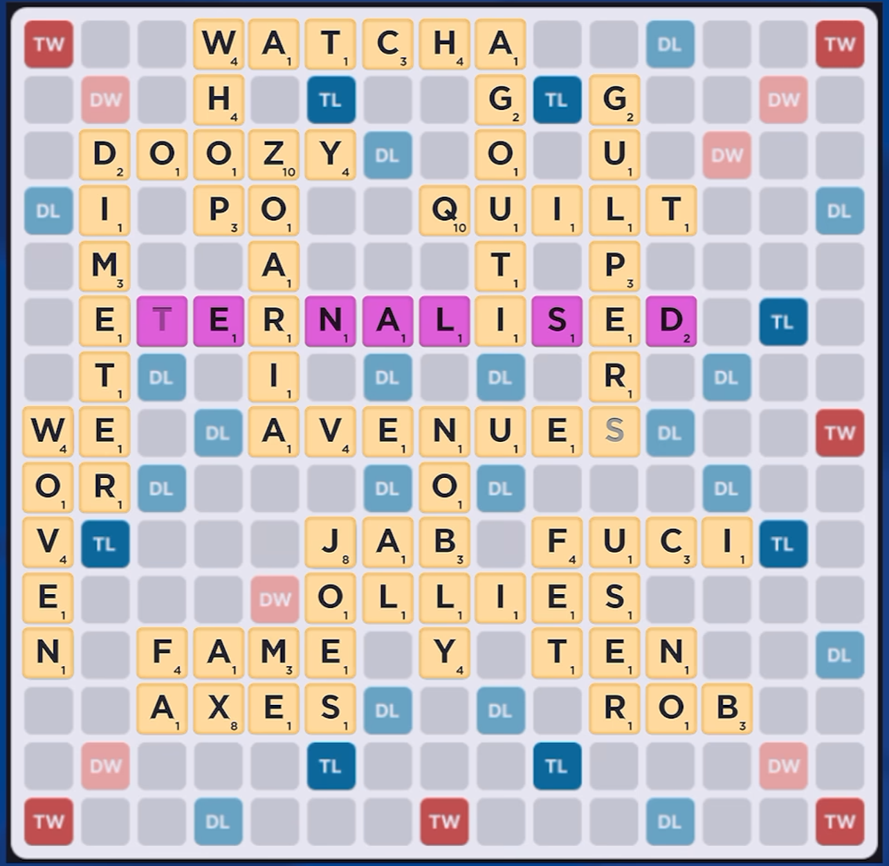

# Scrabble!

## OVERVIEW

I love watching scrabble, but I'm not good at scrabble.. So I'm making you solve some puzzles about it for no reason. 
Your turn to play, there is only one good play. What is it? There's an easy way to do this and a hard way to do it. 

Flag is in the format CTS{word:points}

> Points awarded: 30 
> Disclaimer: The contestants were given a scrabble board that I made (with the help of AI) that was hosted in a repository right here on this account. I hated the repo and killed it. However, I do know where I got my challenge from so I took some pictures from that instead. These images will also be at the bottom, under personal thoughts.

## THE FLAG

Spoilers below!

The flag is:

<code>CTS{eternalised:65}</code>

## INTENDED SOLUTION

The solution is:

I was thinking of 4 different ways to solve this. (3 unique ways). 
Option 1: Be good at scrabble. Not the best way to solve this but it's a method. 
Option 2: Reverse image search my scrabble board. Surely the video wouldn't just pop up... right? 
Option 3: Use an online scrabble solver. It's not the best at solving and I think it can spot this one. 
Option 4: Use Macondo. It's a even more complex scrabble solver that can see this word or sure. 

## PERSONAL THOUGHTS

My personal thoughts on this flag:

 
I was surprised nobody reverse image searched it. I think people were just intimidated by it so nobody solved it. I personally was stunned to see that move go down on the board. As stated in the video, in 100 Million AI vs AI scrabble games where the AIs never miss the best move, an 11 word played through 4 disconnected tiles was only seen 152 times. 

[Will Anderson's Video](https://www.youtube.com/watch?v=c49a1rtZiuw&amp;t=266s) 

Difficulty (out of 100): 8 or 11
Reason: 8 for the people who reverse searched it. 11 for those who put it into a free scrabble solver.

## IMAGES OF THE SCRABBLE BOARD

Scrabble Board Images

 

