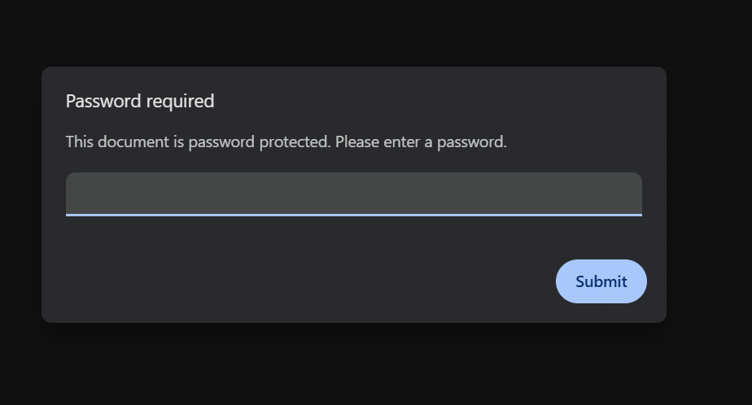
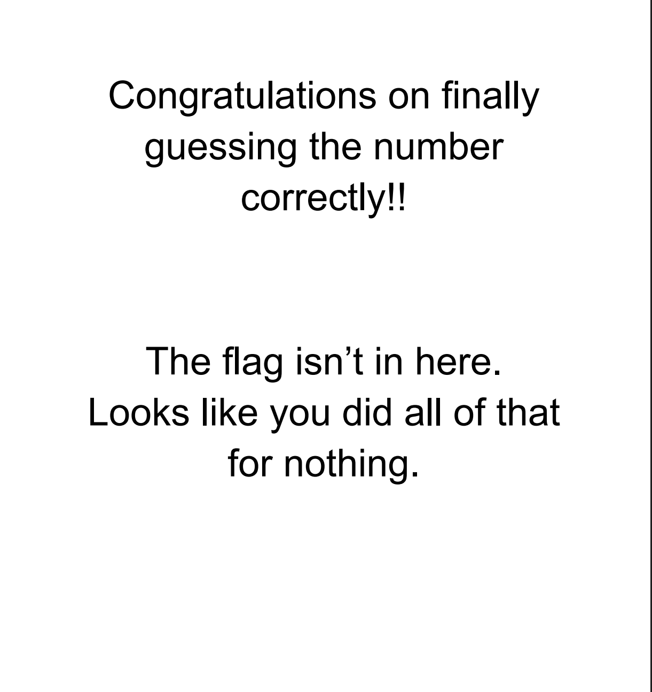
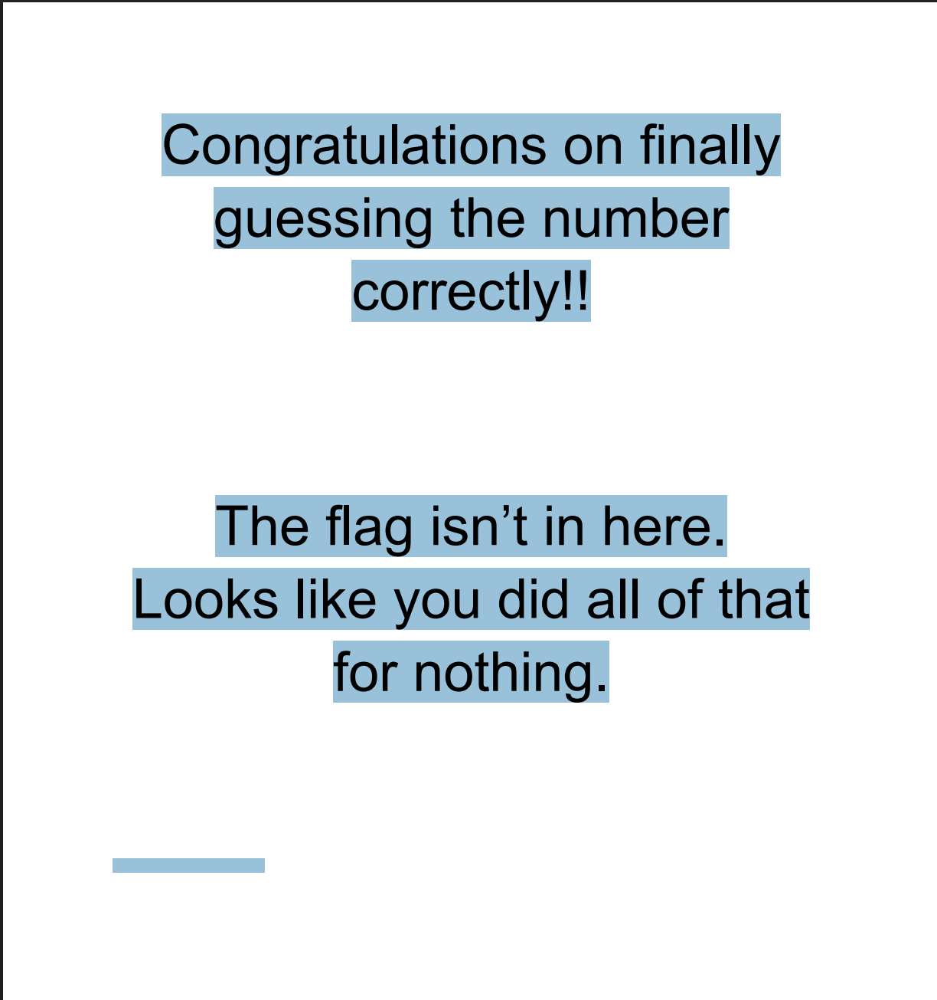

# The Guessing Game

## OVERVIEW

A literal guessing game with a sweet finale. 
I'd suggest you get your weakest member to do this challenge. 
 
And if you don't have a team... HAHAHAHAHA!! 
The password is a number from 1 to 500. 

> Points awarded: 25 
> Disclaimer: The contestants were given the actual PDF. GitHub cannot load a PDF's embedded code while it has a password protection on it, therefore, it would be about as useful as a corrupted txt file. Instead, I have provided a section called images of the PDF, located at the bottom for you all to see what the contestants saw. I hope this is an acceptable solution.

## THE FLAG

Spoilers below!

The flag is:

<code>CTS{n0th1ng_t0_s33_h3r3}</code>

## INTENDED SOLUTION

The solution is:

Guessing the number 318 by pure chance or a password cracker. Also Ctrl + A lets you see all the text, including font size 8 white text.

## PERSONAL THOUGHTS

My personal thoughts on this flag:

 
This was fun to make because of the white text. I was going to make the white text smaller but decided I didn't feel like remaking the PDF. I also made this challenge solely for the people who didn't know anything but wanted to contribute. Also the number 318 has nothing special to me. I was also originally going to put the white text above some of the big black text. 
 
Difficulty (out of 100): 8 (for the password crackers), Gingerbread + 3 (for the guessers)
Reason: Gingerbread for the random guessing, 5 for the password crackers, 3 for the white text. Easy and frustrating at the same time in one challenge.

## IMAGES OF THE PDF

  PDF Images.

   
   
   

