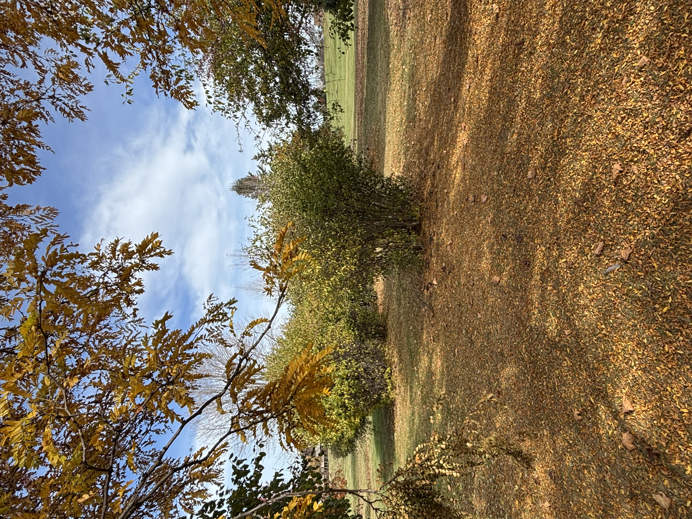

# Hidden Away

## OVERVIEW

Last night, me and my buddy were supposed to go to Lockwood to study together. 
He was late as always and told me to wait for him (like every other day). 
I asked for his location but he wouldn't give it to me. 
Instead, he likes to send the worst images ever. 
 
Flag is in the format: CTS{name_of_location} 
No dots. 

> Points awarded: 40

## THE FLAG

Spoilers below!

The flag is:

<code>CTS{charles_e_puffer}</code>

## INTENDED SOLUTION

The solution is:

To the left you can see governors. To the right you can see the math building. Using google maps and seeing where I was standing, you had to use street view to see the sign I was standing next to. 

## PERSONAL THOUGHTS

My personal thoughts on this flag:

 
Took this image 11 minutes after "I spy with my little eye...". I knew this place existed and I always thought the name was Claudia E. Puffer. I always walked through that area to get to the barber shop on Sweet Home Rd when I lived in Governors. 
 
A lot of people during the event guessed Governors and/or Governors. I should have specified to name the grove I was standing in. I felt like if I had said grove, it would have given it away.  
 
Before the event, I put the image in and asked for people to see if they could identify it. Alyssa asked if it was even possible to find the name of the area. I used google maps and was pleased to see that you can see the signage for the grove from the street view.  
 
Difficulty (out of 100): 27  
Reason: It's not too hard to find it once you know the buildings in the background. The hard part was trying to figure out the name of the place which was hard to see on google maps.

