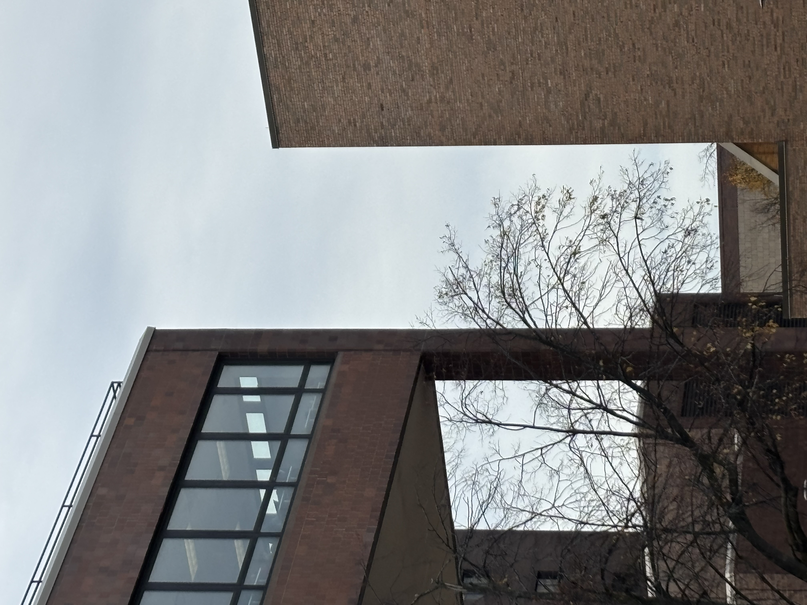

# I spy with my little eye...

## OVERVIEW

Snapped a picture for my instagram. People are asking me where I took this image but I don't remember because it was so long ago.

Flag is in the format CTS{hallName}. You do not need to type the word "hall".

> Points awarded: 15

## THE FLAG

Spoilers below!

The flag is:

<code>CTS{capen}</code> or <code>CTS{fronczak}</code>

## INTENDED SOLUTION

The solution is:

This is a challenge made for UB Students. Capen is one of the most popular halls due to there being Silverman Library (featured in the picture) and also One World Cafe. The hall featured on the right side is Fronczak Hall, which is why that was also accepted.

## PERSONAL THOUGHTS

My personal thoughts on this flag:

 
This is the flag that I screwed up the most making. I forgot that I like to keep my profile private. When I saw my bio from a contestant's POV, it was hidden. I ended up writing this one on the whiteboard to fairly compensate everyone. There were challenges that were way harder than 10 points anyways. Completely my fault for not asking someone to test it.  
   
I thought that going on idle (so I would appear at the top) would have made it nice enough to find (because my name is literally a smiley face on discord)  
   
Difficulty (out of 100): 1  
Reason: Broken flag, will not do this type of flag in the future unless we can test it to make sure others can see the bio.

