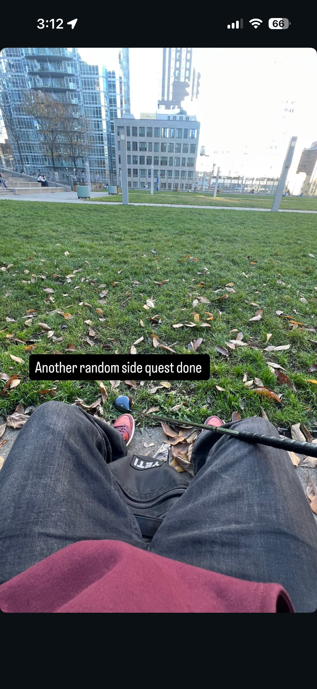

# I spy with my little eye...

## OVERVIEW

I literally sniped this from my friend's instagram page. Tell me what university he goes to. (2 word answer)

Flag is CTS{University Name}

> Points awarded: 25

## THE FLAG

Spoilers below!

The flag is:

<code>CTS{capen}</code> or <code>CTS{fronczak}</code>

## INTENDED SOLUTION

The solution is:

This is a challenge made for UB Students. Capen is one of the most popular halls due to there being Silverman Library (featured in the picture) and also One World Cafe. The hall featured on the right side is Fronczak Hall, which is why that was also accepted.  
   
I'll be honest, I'm not sure how to solve it for a non-UB student.

## PERSONAL THOUGHTS

My personal thoughts on this flag:

 
I took this image on the way to the location of "Hidden Away". I thought this would be obscure enough but it was not. A very nice introduction to OSINT for those who don't know about it  
 
Difficulty (out of 100): 2 (for UB Students), Gingerbread (for non-UB students) 
Reason: Way easier than intended, almost every group that opened the image got the location.

